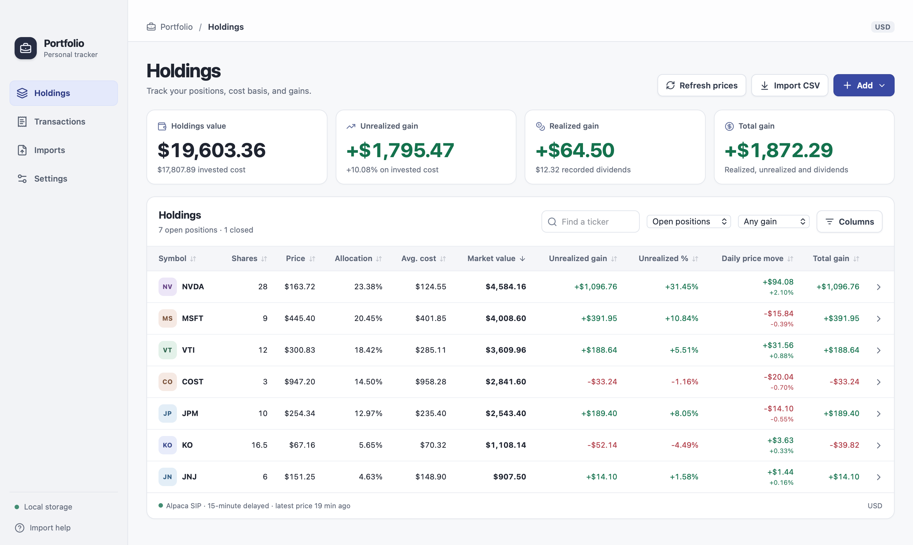
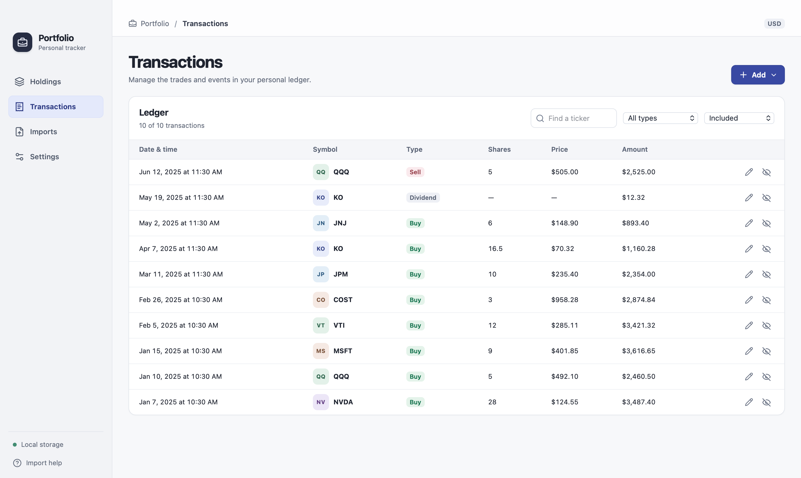
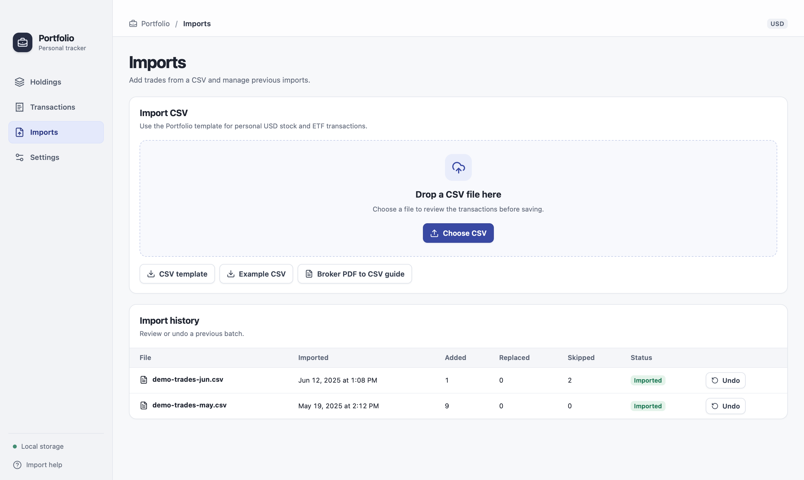

# Portfolio

A free desktop portfolio tracker for US stocks and ETFs. Import your trades, see your positions and gains, and keep your ledger on your Mac. Portfolio works offline with manual prices and can fetch delayed quotes through Alpaca.

**[Download Portfolio for Mac · Apple silicon](https://github.com/surkhayka/portfolio-tracker/releases/latest/download/Portfolio-macOS-Apple-silicon.zip)** · [Release notes and downloads](https://github.com/surkhayka/portfolio-tracker/releases)

## Screenshots

All screenshots use fictional trades and prices.



<details>
<summary>Show the Transactions and Imports screens</summary>





</details>

## Install

1. Download the ZIP above and unzip it.
2. Move **Portfolio.app** to **Applications** and open it. For an update, quit the existing copy before replacing it. Your ledger lives in macOS Application Support.
3. This release is built for Apple silicon and uses ad hoc signing. If macOS prompts you about the download, see [Apple’s guide to opening apps safely](https://support.apple.com/en-us/102445). macOS may also ask Portfolio to reauthorize access to your saved Alpaca credentials after an update.

## Start tracking

- **Try it with sample data.** Open **Imports** and load the [synthetic example CSV](public/portfolio-example.csv). You can undo that import from **Import history**.
- **Import your own trades.** Use the [CSV template](public/portfolio-template.csv) or follow the [broker PDF-to-CSV guide](public/broker-pdf-to-csv.md). Portfolio previews changes, flags conflicts, and checks for duplicate IDs before import. You can exclude individual trades you do not want counted.
- **Start with current positions.** Choose **Add → Add existing holding** and enter a starting quantity and cost basis. You can add earlier trades later through the import preview.
- **Add automatic prices if you want them.** In **Settings**, connect your own Alpaca key and secret and select the matching Paper or Live account. The app stores credentials in your OS credential store and uses consolidated US prices delayed by at least 15 minutes. Automatic refresh runs about every two minutes while Holdings is active. You can switch it off or enter prices manually from a holding’s details.
- **Show company logos if you want them.** Enable **Settings → Company logos** to load logos from [Elbstream](https://elbstream.com/logos) for visible tickers. This setting is off by default. Initials appear when a logo is unavailable.

## What you can track

| View | What it shows |
| --- | --- |
| **Holdings** | Shares, average cost, market value, allocation, daily price move, and gains. Sort columns and filter by ticker, open or closed positions, gain, or missing prices. |
| **Transactions** | Buys, sells, dividends, splits, and opening balances. Filter by ticker, type, and whether a row is included in your totals. |
| **Imports** | Preview, review, and undo imports. Repeated exports with the same transaction IDs keep duplicate trades out of the ledger. |
| **Settings** | Price connection, display timezone, SQLite backups, restore, and CSV export. |

Portfolio tracks long positions in USD using weighted-average cost. Buy fees add to basis. Realized gain is sale proceeds less fees and the basis released by the sale. Total gain combines realized gain, unrealized gain, and recorded dividends. Opening balances only capture gain history from the information you provide. Daily price move compares currently held shares against the previous regular session close. Broker figures can differ because of rounding, recorded fees, or a different cost method.

## Local data and backups

On macOS, the SQLite ledger and cached prices are stored under `~/Library/Application Support/app.portfolio.local`. **Settings → Create backup** saves a complete SQLite copy. CSV export contains active transactions for portability. Alpaca credentials stay in Keychain and are excluded from exports and backups. Portfolio sends the symbols needed for quote requests to Alpaca when refreshing prices.

## Build from source

Install Node.js 22 or later, stable Rust, and the Xcode command line tools. The desktop app uses Tauri, Rust, React, TypeScript, and SQLite.

```sh
npm ci
npm run tauri dev
```

```sh
npm test
cargo test --locked --manifest-path src-tauri/Cargo.toml
npm run tauri build -- --bundles app -- --locked
```

By default, the build writes `Portfolio.app` to `src-tauri/target/release/bundle/macos/`. To run the built app against a separate test ledger, set `PORTFOLIO_DATA_DIR` to an absolute scratch directory before launching the executable.

For bugs or feature requests, [open an issue](https://github.com/surkhayka/portfolio-tracker/issues/new). Include your app version and steps to reproduce. Use sample data when attaching CSVs or screenshots.

## License

[MIT](LICENSE)
